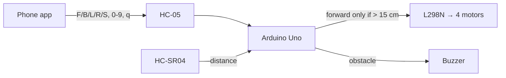

<h1 align="center">🚗 Bluetooth RC Car with Collision Stop · Arduino Uno</h1>

Drive it from a phone; it refuses to drive forward into anything closer than 15 cm.

  
  
  

> The repo name says *obstacle avoidance*. The code is a **phone-controlled car with a collision
> guard**: it blocks forward moves near obstacles and beeps, but it doesn't steer around them by
> itself. See [Status](#status--known-issues).

## Overview

- **Drive** with any Bluetooth RC app over an HC-05/06 (`F B L R S`).
- **Speed slider:** `0`–`9`, `q` set the PWM from 100 to 255.
- **Collision guard:** when you press forward, it checks the HC-SR04. Under 15 cm it stops and beeps every 0.5 s.

## How it works

## Hardware

| Part | Pins |
|---|---|
| Arduino Uno | — |
| HC-05 / HC-06 (SoftwareSerial) | 10, 11 |
| L298N | ENA 5, ENB 6, IN1–IN4 7, 8, 9, 4 |
| HC-SR04 | TRIG 2, ECHO 3 |
| Buzzer | 12 |
| 4WD chassis + BO motors, battery | — |

## Run it

1. Upload `Arduino_Bluetooth_Car.ino` with the HC-05 **disconnected** (it shares the serial line during upload).
2. Pair the phone with the HC-05 (PIN `1234` or `0000`).
3. In a Bluetooth RC car app, map the buttons to `F B L R S` and the slider to `0`–`9` / `q`.

## Status & known issues

| Issue | Effect | Fix |
|---|---|---|
| Distance is only checked **when a command arrives** | Already driving forward, it won't stop for a new obstacle until the next command | Check distance every loop while moving forward |
| No autonomous avoidance or servo scan in the code | Doesn't match the old description | Add a scan-and-turn routine (servo listed in the parts) |
| Single fixed-angle ultrasonic | Misses obstacles off-axis | Servo sweep or two sensors |
| L298N drops ~2 V and heats up | Weaker motors, warm driver | TB6612FNG |

## Roadmap

- [ ] Continuous collision check while moving
- [ ] Autonomous mode: servo-scanned HC-SR04, turn to the clearest side
- [ ] Upload circuit diagram and photos
- [ ] ESP32 version with Wi-Fi telemetry
